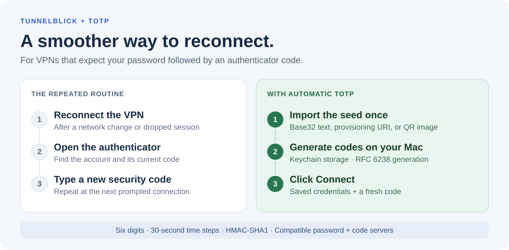
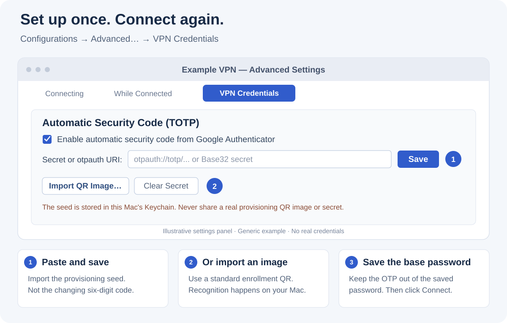

# Tunnelblick with automatic TOTP

**English** | [简体中文](README.zh-CN.md)

**Reconnect to your VPN without typing a fresh authenticator code every time.**

An independently maintained [Tunnelblick](https://github.com/Tunnelblick/Tunnelblick) fork that imports your TOTP provisioning secret once, generates compatible security codes on your Mac, and appends them to your VPN password when you connect.

**8.0.2 · build 6304** &nbsp; | &nbsp; **macOS 13+** &nbsp; | &nbsp; **Apple Silicon + Intel** &nbsp; | &nbsp; **GPL-2.0**



## Why this version exists

Some OpenVPN servers require a password followed by a six-digit code from Google Authenticator or another compatible authenticator. Connecting in the morning, switching networks, waking a laptop, or recovering from a dropped connection can mean opening the authenticator and typing another code. Repeating that routine throughout the day quickly becomes frustrating.

This fork adds a one-time setup for compatible TOTP accounts. After importing the provisioning secret and saving your VPN credentials, click **Connect**: the client generates the current code locally and submits `password + code`. When automatic TOTP authentication is rejected, it can wait for the next time step and retry without asking you to choose saved credentials again.

QR recognition is used during setup to read a provisioning secret. Connection-time codes are generated using RFC 6238; this feature does not solve image CAPTCHAs or read codes from another app's screen.

## What it adds

- **One-time secret import.** Paste a Base32 secret or an `otpauth://totp/...` provisioning URI, or import a QR image.
- **Local code generation.** Generate six-digit, 30-second, HMAC-SHA1 codes compatible with standard Google Authenticator TOTP accounts. No external code-generation service is used.
- **Fewer login prompts.** Skip the login window when the username and base password are saved in Keychain and automatic TOTP is enabled.
- **Fresh codes at submission.** Refresh the code when a login window is submitted. Automatic connections wait for the next code if the current code has five seconds or less remaining.
- **Bounded automatic retries.** Wait for a new code after an automatic TOTP authentication failure, with at most two retries. Disconnect cancels pending work.
- **Existing credentials groups.** Store the secret in macOS Keychain under the same credentials-group rules as the VPN username and password.
- **A responsive Info page.** Contributor credits use native text and manual scrolling instead of continuous animated table redraws.

## Get started

### 1. Install the TOTP build

Download **[Tunnelblick TOTP 8.0.2 (build 6304)](https://github.com/webLiang/Tunnelblick/releases/tag/totp-8.0.2-build6304)** from this fork's Releases page. The Universal application supports Apple Silicon and Intel. The official Tunnelblick download does not include this extension. You can also [build from source](#build-and-test).

- [Application ZIP](https://github.com/webLiang/Tunnelblick/releases/download/totp-8.0.2-build6304/Tunnelblick-8.0.2-macos-universal.zip)
- [Corresponding source ZIP](https://github.com/webLiang/Tunnelblick/releases/download/totp-8.0.2-build6304/Tunnelblick-8.0.2-source.zip)
- [SHA-256 checksums](https://github.com/webLiang/Tunnelblick/releases/download/totp-8.0.2-build6304/SHA256SUMS.txt)

The release script creates a Universal application ZIP, matching source ZIP, and SHA-256 checksums. Extract the application ZIP and open `Tunnelblick.app` to follow its installation or replacement flow. Administrator authorization may be required; existing configurations are retained by the installer.

Local builds use ad hoc signing and are not Apple-notarized. The release notes describe the signing status and installation details. The fork does not provide its own automatic-update feed.

### 2. Import your provisioning secret

Open **VPN Details → Configurations**, select a profile, then choose **Advanced… → VPN Credentials**.



Choose either setup method:

- **Text:** paste the Base32 secret or a standard `otpauth://totp/...` URI into **Secret or otpauth URI**, then click **Save**.
- **QR image:** click **Import QR Image…** and select the provisioning QR image supplied by your account's enrollment flow. Supported image formats include PNG, JPEG, GIF, BMP, and TIFF.

Saving or importing a secret enables **Enable automatic security code from Google Authenticator**. The saved secret is masked in the settings panel.

Use the provisioning secret, not the changing six-digit code. Google Authenticator transfer/export QR codes using `otpauth-migration://` are not supported. Import extracts the secret only; URI algorithm, digit-count, and period parameters are not applied. Confirm that the account uses **HMAC-SHA1, six digits, and a 30-second period** before enabling this feature.

### 3. Save the base password and connect

Connect once and save the VPN username and **base password** in Keychain. Do not append a one-time code to the saved password; Tunnelblick adds a fresh code during authentication.

On subsequent supported connections, click **Connect**. If credentials are complete, the login window is skipped. A login window also provides a **Configure automatic security code…** shortcut when initial setup is needed.

If an automatically generated code is rejected, the client waits for the next time step and retries, up to **three total authentication attempts**: one initial attempt and two retries. It then stops and records the failure in the connection log, with a system notification when available. Wrong credentials or an incompatible server still need to be corrected.

### Change or remove the secret

Return to **VPN Credentials** and use **Clear Secret** to remove the stored seed. Disable the automatic-code checkbox to stop automatic generation while retaining the seed. The existing manual security-code login flow remains available.

## Compatibility and security

The supported server flow expects the security code **appended directly to the password**. HOTP, push approvals, WebAuthn, SMS codes, custom token formats, and arbitrary interactive challenges are outside this feature's scope. Existing challenge and manual-authentication handling remains in place.

The provisioning secret is stored in **macOS Keychain**, scoped to the credentials group. Profiles sharing a group also share its TOTP secret. The TOTP component uses CommonCrypto for generation and Apple's Vision framework for QR recognition; it does not send the seed to a third-party recognition service. The resulting password and code are submitted to your configured VPN server through OpenVPN authentication.

Keeping both the password and authenticator seed on one Mac reduces the separation between authentication factors. Use it where your account administrator permits local seed storage, protect the Mac, and never share a real provisioning QR image or seed. If the Mac or seed is compromised, revoke and re-enroll the seed on the server. Keep the Mac's date and time synchronized.

## Build and test

Build on macOS with full Xcode and its command-line tools installed. The release workflow is validated with **Xcode 16.4**. See the [upstream build guide](Building%20Tunnelblick%20from%20Source%20Code.markdown) for GNU autotools, Rosetta, and other prerequisites; this fork's configured deployment target is macOS 13.

```sh
# Offline regression tests; no real Keychain or VPN server is accessed.
python3 tests/run-tests.py

# Xcode Release build, Universal validation, signing checks, and ZIP packaging.
bash scripts/build-release.sh
```

Outputs are written to `dist/`:

```text
Tunnelblick-8.0.2-macos-universal.zip
Tunnelblick-8.0.2-source.zip
SHA256SUMS.txt
```

The packager checks both CPU architectures, the app signature, bundled library paths, and all four OpenVPN engines. On Apple Silicon it also runs the Intel engines through Rosetta. Offline tests cover RFC 6238 vectors, expiry boundaries, retries, cancellation, saved-credential login, and challenge isolation. Live VPN compatibility depends on the server configuration.

## Documentation and support

- [TOTP implementation and storage](docs/TOTP.md)
- [8.0.2 release notes](docs/RELEASE-8.0.2.md)
- [Setup and troubleshooting](docs/SETUP.md)
- [GitHub publishing notes](docs/PUBLISHING.md)

Report TOTP-specific problems in [this fork's issue tracker](https://github.com/webLiang/Tunnelblick/issues). Include the fork version, macOS version, and reproduction steps. Remove usernames, server addresses, and other private details from logs; never attach a secret, enrollment QR image, password, private key, or live VPN profile.

## Upstream and license

This is an independent extension based on **Tunnelblick 8.0.1**. Its version **8.0.2** identifies this fork's release line; it is not an official Tunnelblick release or a claim of endorsement by Tunnelblick, Google, or OpenVPN.

- Official project: [Tunnelblick/Tunnelblick](https://github.com/Tunnelblick/Tunnelblick)
- Official website and documentation: [tunnelblick.net](https://tunnelblick.net)
- License: [GNU General Public License, version 2](COPYING)

Upstream copyright notices, contributor credits, and translations are retained. All illustrations in this README were created for public documentation with generic labels and no live credentials or organizational screenshots.
