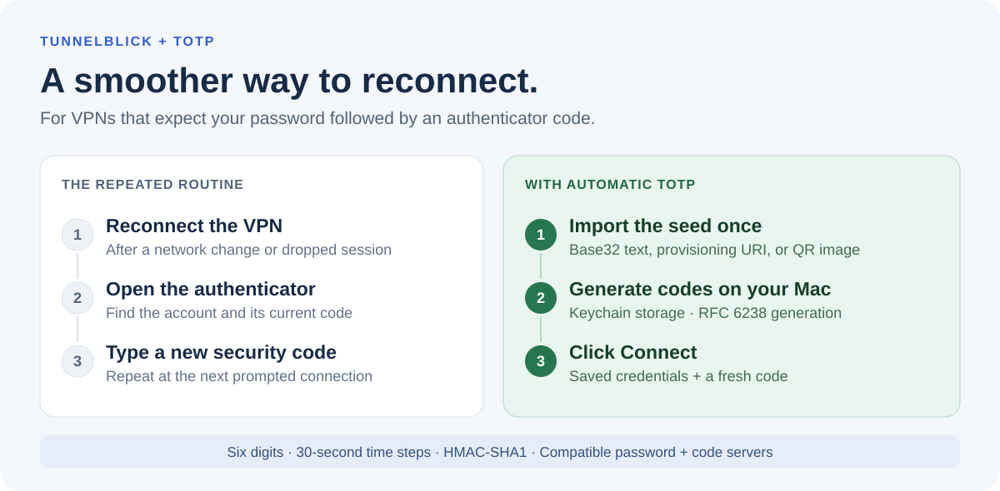
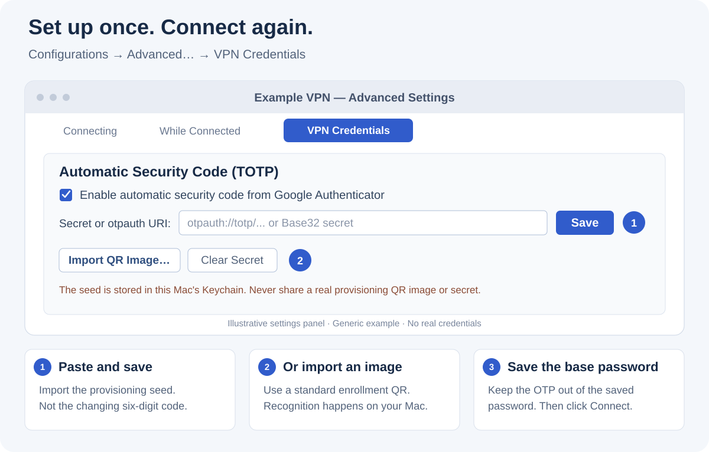

# Tunnelblick 自动 TOTP 版本

[English](README.md) | **简体中文**

**连接或重连 VPN 时，无需反复打开身份验证器、手动输入安全码。**

这是基于开源 [Tunnelblick](https://github.com/Tunnelblick/Tunnelblick) 独立维护的扩展版本。首次导入 TOTP 根密钥后，应用会在本机生成兼容的动态安全码，并在连接时自动追加到 VPN 密码末尾。

**8.0.2 · build 6304** &nbsp; | &nbsp; **macOS 13 及以上** &nbsp; | &nbsp; **Apple Silicon + Intel** &nbsp; | &nbsp; **GPL-2.0**



## 为什么有这个版本

一些 OpenVPN 服务要求使用“基础密码 + Google Authenticator 等身份验证器生成的 6 位安全码”登录。每天首次连接、切换网络、电脑休眠唤醒，或者断网后重新连接，都可能需要重新打开身份验证器、找到账号，再输入一遍安全码。一天重复几次，就会很打断工作。

这个版本把重复操作变成一次配置：导入该账号的 TOTP 根密钥，再保存 VPN 用户名和基础密码。之后点击连接时，客户端会自动生成当前安全码，以 `基础密码 + 安全码` 的形式完成认证。自动 TOTP 认证失败时，也可以等待下一轮新码后重试，减少再次选择已保存凭证的操作。

二维码识别发生在首次设置时，用于提取根密钥。连接时的动态码按 RFC 6238 在本地生成；此功能不用于识别图片验证码，也不会读取其他应用屏幕上的验证码。

## 增加了哪些功能

- **一次导入，多次使用**：支持 Base32 根密钥、`otpauth://totp/...` 配置 URI，以及二维码图片导入。
- **在本机生成安全码**：使用标准 HMAC-SHA1、6 位、30 秒周期 TOTP，无需外部验证码生成服务。
- **减少登录弹窗**：用户名、基础密码已保存在钥匙串且自动 TOTP 可用时，直接连接。
- **提交时使用新码**：登录窗口提交时重新生成安全码；自动连接遇到有效期只剩 5 秒或更少的码，会等待下一轮。
- **有上限的自动重试**：自动 TOTP 认证被拒绝后等待新码，最多重试两次；点击断开可取消等待。
- **兼容现有凭证组**：根密钥保存在 macOS 钥匙串，沿用 Tunnelblick 的凭证分组规则。
- **修复信息页卡顿**：贡献者名单改为原生文本与手动滚动，去掉持续滚动和富文本表格重绘。

## 下载与安装

前往 **[Tunnelblick TOTP 8.0.2（build 6304）发行页面](https://github.com/webLiang/Tunnelblick/releases/tag/totp-8.0.2-build6304)**，下载本仓库的构建。官方 Tunnelblick 下载不包含本扩展。

- [下载 Universal 应用压缩包](https://github.com/webLiang/Tunnelblick/releases/download/totp-8.0.2-build6304/Tunnelblick-8.0.2-macos-universal.zip)：支持 Apple Silicon 和 Intel。
- [下载对应源码](https://github.com/webLiang/Tunnelblick/releases/download/totp-8.0.2-build6304/Tunnelblick-8.0.2-source.zip)
- [下载 SHA-256 校验文件](https://github.com/webLiang/Tunnelblick/releases/download/totp-8.0.2-build6304/SHA256SUMS.txt)

退出 Tunnelblick，解压应用包，打开其中的 `Tunnelblick.app`，按自带安装流程安装或替换应用。安装可能要求管理员授权；安装器会保留已有 VPN 配置。

该发行包使用本地 ad hoc 签名，未进行 Apple Developer ID 签名和 Apple 公证。确认下载来源及校验值后，如 macOS 阻止首次打开，可按系统提示在“系统设置 → 隐私与安全性 → 仍要打开”中操作。无需关闭系统级安全保护。本 fork 尚未提供独立的自动更新源。

## 配置步骤

### 1. 打开自动安全码设置

打开 **VPN 详细信息 → 配置**，选择 VPN，再进入 **Advanced… → VPN Credentials**。



图中使用英文界面示意；按钮名称会随应用语言变化。

### 2. 导入根密钥或二维码图片

选择以下一种方式即可：

- **文本导入**：将 Base32 根密钥或标准 `otpauth://totp/...` URI 粘贴到 **Secret or otpauth URI**，点击 **Save**。
- **图片导入**：点击 **Import QR Image…**，选择账号注册或绑定身份验证器时提供的二维码图片。支持 PNG、JPEG、GIF、BMP、TIFF。

保存或导入成功后，会自动启用 **Enable automatic security code from Google Authenticator**。已保存的根密钥在设置面板中以掩码显示。

这里需要的是用于生成验证码的**根密钥或配置二维码**，不是每 30 秒变化的 6 位数字。Google Authenticator 的 `otpauth-migration://` 多账号迁移二维码不支持导入。

当前实现只提取 URI 中的密钥，不应用其中的算法、位数和周期参数。请先确认账号使用 **HMAC-SHA1、6 位、30 秒周期**。

### 3. 保存基础密码并连接

首次连接时，保存 VPN 用户名和**基础密码**。不要把一次性安全码写进保存的密码，应用会自动追加新码。

之后在凭证完整且自动 TOTP 可用时，点击连接即可跳过登录窗口。首次配置也可以使用登录窗口中的 **Configure automatic security code…** 快捷入口。

自动 TOTP 认证被拒绝后，应用等待下一轮新码再试，通常每次等待约 1～31 秒。总共最多尝试三次：首次认证加两次重试。仍然失败时停止连接、写入日志，并在系统通知可用时发送通知。错误的密码、密钥或不兼容的服务端流程仍需手动修正。

### 4. 停用或删除

取消自动安全码选项，可以保留根密钥并恢复手动输入。点击 **Clear Secret** 会删除本机保存的根密钥。与同一凭证组关联的 VPN 配置共用该密钥，修改时需要注意影响范围。

## 适用范围与密钥存储

支持的服务端登录格式是**基础密码后直接拼接安全码，不加分隔符**。HOTP、短信验证码、推送确认、WebAuthn、自定义令牌格式及任意交互式挑战不属于本功能的支持范围；原有手动登录和挑战处理流程仍保留。

根密钥保存在 **macOS 钥匙串**中，以凭证组为单位隔离。TOTP 计算使用 CommonCrypto，二维码识别使用 Apple Vision，不会把根密钥发送给第三方识别服务。密码及生成的安全码仍会通过 OpenVPN 认证提交给你配置的 VPN 服务器。

将密码和根密钥保存在同一台电脑，会降低不同认证因素之间的隔离程度。请在账号管理方允许的情况下使用，保护好电脑，不要分享真实根密钥或二维码；如果设备或密钥泄漏，应在服务端撤销并重新绑定。电脑时间也应保持准确。

## 从源码构建

需要 macOS、完整 Xcode 及命令行工具。发行流程已使用 **Xcode 16.4** 验证。GNU autotools、Rosetta 等依赖请参考[上游构建说明](Building%20Tunnelblick%20from%20Source%20Code.markdown)；本 fork 的最低系统版本配置为 macOS 13。

```sh
# 离线回归测试，不读取真实钥匙串，不连接 VPN 服务器。
python3 tests/run-tests.py

# Xcode Release 构建、Universal 验证、签名检查与 ZIP 打包。
bash scripts/build-release.sh
```

输出目录为 `dist/`：

```text
Tunnelblick-8.0.2-macos-universal.zip
Tunnelblick-8.0.2-source.zip
SHA256SUMS.txt
```

打包时检查应用签名、CPU 架构、动态库依赖和四套 OpenVPN 引擎；Apple Silicon 环境还会通过 Rosetta 验证 Intel 引擎。离线测试覆盖标准 TOTP 向量、有效期边界、自动重试、取消、保存凭证登录及挑战流程隔离；真实服务端兼容性需要按实际配置验证。

## 文档与反馈

- [TOTP 实现与存储说明（英文）](docs/TOTP.md)
- [8.0.2 发行说明（英文）](docs/RELEASE-8.0.2.md)
- [配置与故障排查（英文）](docs/SETUP.md)
- [发布维护说明（英文）](docs/PUBLISHING.md)

TOTP 扩展的问题请提交到[本 fork 的 Issues](https://github.com/webLiang/Tunnelblick/issues)，注明应用版本、macOS 版本和复现步骤。上传前请删除日志中的用户名、服务器地址等私有信息，不要提交根密钥、二维码、密码、私钥或真实 VPN 配置。

## 上游与许可

本项目基于 **Tunnelblick 8.0.1** 独立扩展，**8.0.2** 是本 fork 的版本号，不代表官方 Tunnelblick 发行，也不代表 Tunnelblick、Google 或 OpenVPN 对本扩展的背书。

- 官方项目：[Tunnelblick/Tunnelblick](https://github.com/Tunnelblick/Tunnelblick)
- 官方网站：[tunnelblick.net](https://tunnelblick.net)
- 许可证：[GNU General Public License, version 2](COPYING)

保留上游版权声明、贡献者署名和已有翻译。本文配图是重新制作的通用示意图，不含真实凭证、组织内部界面或生产配置。
